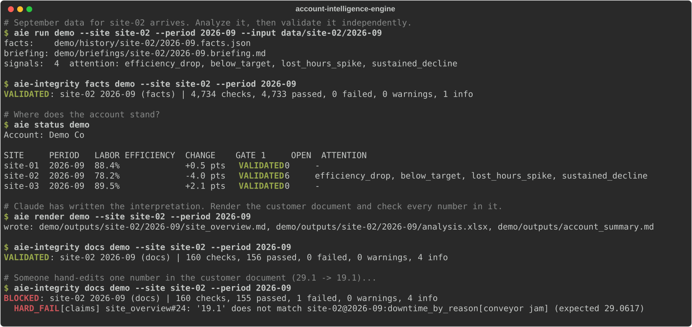
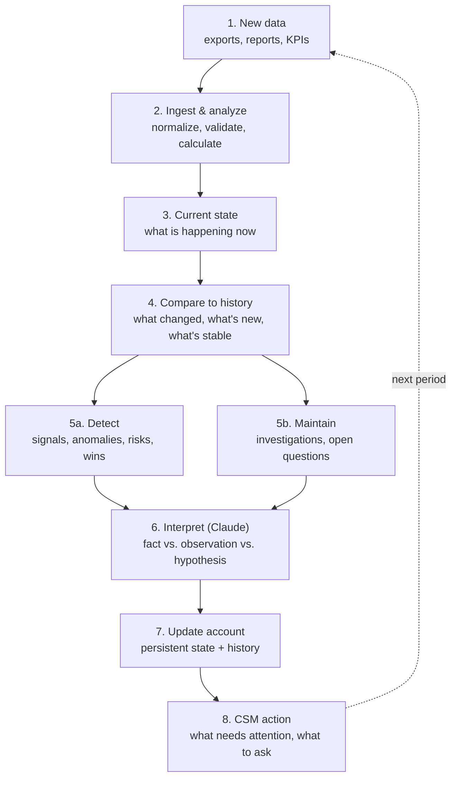
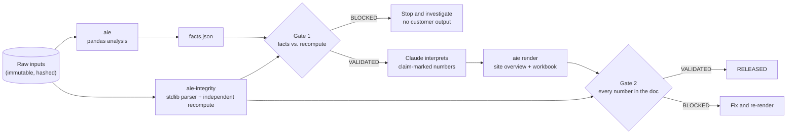

# Account Intelligence Engine

**Turns monthly operational data into an account picture that builds over time, checks every number with a second, independent engine, and tells the customer success manager (CSM) what to do next.**

   



---

## The problem

Every month, a CSM managing a multi-site customer gets a stack of exports and has a few days to answer three questions:

1. **What changed, and does it matter?**
2. **What should I raise with the customer, and how?**
3. **Can I defend every number I'm about to put in front of them?**

Most teams answer the first two from memory and spreadsheets, and the third on hope. One wrong number in a business review costs more trust than ten right ones earn.

## What this does

| | |
|---|---|
| **Remembers the account** | Every period is stored with full history. Investigations ("efficiency dropped at site-02") stay open across months and resolve only when the metric actually returns toward its pre-problem level, not just when an alert goes quiet. |
| **Finds what changed** | Compares each period to the last one and to a trailing baseline. Declarative rules flag drops, misses against target, statistical anomalies, new top problems, and slow multi-month trends. Driver evidence (efficiency on downtime-event days vs. other days, plus weekly trend) helps separate causes from coincidences. |
| **Proves its numbers** | A second engine that **shares no code** with the first re-reads the raw files, recomputes everything, and blocks release on any mismatch. That includes every input cell, so a typical month runs about 4,500 checks. |
| **Hides tags in documents** | Every number in a customer document carries a hidden reference to the fact it came from. Hand-edit one, and the release is blocked. |
| **Writes the CSM briefing** | What needs attention, what to ask the customer, and wins to share. Claude adds the interpretation, labeled *fact*, *observation*, or *hypothesis*. |

## A 5-minute tour

You don't need to install anything to evaluate this.

1. **See the output:** [`examples/sample-output/`](examples/sample-output/) has a real CSM briefing, a customer-ready site overview, an account summary, and integrity reports, all from the demo.
2. **See it catch a mistake:** [the blocked example](examples/sample-output/06-integrity-BLOCKED-example.md) shows one hand-edited number in a finished document being stopped.
3. **See the spec:** [`pack.yaml`](src/aie/packs/ops/pack.yaml) holds every metric definition, exclusion rule, and detection threshold in one readable file.
4. **See the validator:** [`facts_check.py`](src/aie_integrity/facts_check.py) shows what "independently verified" means here, category by category.
5. **See the AI layer:** [`skills/`](skills/) shows how Claude is told to route work, interpret results, and never work around a failed check.
6. **See an honest benchmark:** [`docs/benchmark.md`](docs/benchmark.md) compares this against plain Claude working from raw exports. It costs about the same in tokens or slightly less, and is 32 to 43% faster with verified numbers. One round lost on root-cause analysis, and that loss drove a fix.
7. **See how it was tested beyond its own demo:** [`docs/field-testing.md`](docs/field-testing.md) covers three cold-start Claude sessions running the skills, a 23-scenario messy-data stress test, and every bug they found.

## How it works



### Two engines, two gates



A sentence in a customer document reads normally on screen. In the source, every number carries a hidden tag:

```markdown
Labor efficiency fell to 78.2%<!--claim:efficiency--> this month, down -4.0 pts<!--claim:delta:efficiency-->.
```

Gate 2 resolves each tag, recomputes the value on its own, and checks it within the precision shown. A number with no tag is flagged as unsupported.

## Quickstart

```bash
git clone <this repo> && cd account-intelligence-engine
python -m venv .venv && source .venv/bin/activate
pip install -e ".[dev]"

bash examples/run_demo.sh      # synthetic data -> analysis -> gate 1 -> render -> gate 2
aie status examples/demo-account
pytest                         # 40 tests: end-to-end, tamper, independence, units
python scripts/stress_test.py  # 23 messy-export scenarios vs. the known-correct answer
```

The demo builds **Demo Co**, a fictional account with three sites and six months of synthetic data, with stories planted for the engine to find:

| Site | Planted story | What the engine does |
|---|---|---|
| site-01 | A timekeeping glitch double-clocks shifts in July | Excludes the outlier rows. Warns that the customer's own system reports different totals, and explains why. |
| site-02 | A new downtime cause takes over in August and September | Flags the efficiency drop, the below-target miss, the lost-hours anomaly, and the new top downtime reason. Carries the investigations across both months. |
| site-03 | Starts below target and improves every month. Some June rows point at unknown employees. | Flags the data-quality issue. The below-target investigation goes from open to watching to resolved. |

### Commands

```bash
aie init     ACCOUNT --name "Customer" [--pack ops | --pack-spec my_pack.yaml]
aie run      ACCOUNT --site SITE [--period YYYY-MM] --input DIR [--force]   # period inferred if omitted
aie-integrity facts ACCOUNT --site SITE --period YYYY-MM          # gate 1
aie render   ACCOUNT --site SITE --period YYYY-MM                  # refuses without gate 1
aie-integrity docs  ACCOUNT --site SITE --period YYYY-MM          # gate 2, writes RELEASED
aie note     ACCOUNT INV-0001 "Maintenance replaced the belt on 9/12"
aie context  ACCOUNT [--site SITE]                                 # everything a Claude session needs, one block
aie-integrity claims ACCOUNT --site SITE --period YYYY-MM         # pre-check Claude's interpretation before render
aie export   ACCOUNT --site SITE --period YYYY-MM                  # clean .md/.html copies of a RELEASED doc
aie name     ACCOUNT site-01 "Riverside plant"                    # display name used in documents
aie status   ACCOUNT [--json]
```

`aie-integrity` exits `0` when validated, `1` when blocked, and `2` on setup errors, so it fits into CI or a scheduled job. Add `--strict` to block on warnings too.

## Using it with Claude

| Skill | Role |
|---|---|
| [`account-intelligence`](skills/account-intelligence/SKILL.md) | Orchestration. Figures out the task, loads only what's needed, runs the loop, and answers "what needs attention?" |
| [`site-analysis`](skills/site-analysis/SKILL.md) | Interpretation. Writes the fact, observation, and hypothesis narrative with every number tagged. |
| [`integrity-check`](skills/integrity-check/SKILL.md) | Runs both gates, diagnoses failures, and never works around a block. |

Copy the folders into `~/.claude/skills/` (or into `.claude/skills/` in a project). Then ask something like *"September data for site-02 is in ./drop. Run it and tell me what needs attention."*

## Field-tested

The system was tested beyond its own demo in two ways ([full write-up](docs/field-testing.md)):

- **Three cold-start Claude sessions** got only the skills and a realistic CSM request (call prep, then a multi-site QBR). Each one followed the gates, tagged every number, and released valid documents. Each one also reported friction, and that turned into fixes. Two highlights: the first session caught a real design flaw (a persistent problem being marked as improving because the baseline absorbed it), and the third caught a detection gap (a five-month improvement that no single month flagged).
- **A messy-data stress test** of 23 realistic export problems (title rows, BOMs, US dates, totals rows, duplicates, payroll reversals, ID case mismatches, semicolon delimiters, multi-sheet workbooks, and more). Before fixes, 1 crashed and 4 came out wrong. Now 21 are handled correctly and 2 are refused on purpose with a clear message. CI fails if any scenario ever produces wrong numbers silently.

## Efficiency, measured

Compared with a fresh Claude session working from the raw CSVs with Python, the current version uses about the same tokens for one-site call prep (+3%) and 10% fewer for a three-site QBR. It finishes 32 to 43% faster, and every number in its customer documents is independently verified. An earlier version missed a root cause that plain Claude found by drilling into raw rows. Driver analysis and hypothesis testing were added, and all eight runs since have found it. Full method and data: [docs/benchmark.md](docs/benchmark.md).

## Design decisions

| Decision | Why |
|---|---|
| **Python does the math, Claude does the meaning** | Language models are great at explaining numbers and unreliable at producing them. Claude only cites values the engine computed, and every citation is checked. |
| **A second engine instead of self-checks** | A check that reuses the same code reproduces the same bug. The validator uses a different parser (stdlib `csv`, not pandas) and a different math path, and a test fails the build if it ever imports the analysis engine. |
| **One spec, two implementations** | `pack.yaml` defines every metric in plain words. When the two engines disagree, the spec was ambiguous, and you find out before the customer does. |
| **Rules for detection, AI for interpretation** | What counts as a "drop" should be reviewable, tunable, and the same every month. Why it dropped is where judgment helps. |
| **Plain files for state** | JSON, Markdown, and CSV in one folder per account. Easy to diff, easy to version with git, and readable by Claude with no extra tooling. Right for one CSM's book of business. A team deployment would move state to a database behind the same interfaces. |
| **Immutable, hashed inputs** | Re-running reproduces the same facts. Replacing a period's data takes `--force` and is logged. |

## Domain packs

Everything domain-specific lives in a pack. The core (state, comparison, detection, investigations, both gates, claim checks, document layout) has no knowledge of any one domain.

The bundled **`ops`** pack covers labor performance for multi-site operations, such as plants, warehouses, kitchens, and service centers. It tracks earned versus paid hours, efficiency, lost hours, and downtime. A pack is a `pack.yaml` spec, an analyzer, and an independent recompute. See [docs/domain-packs.md](docs/domain-packs.md).

```yaml
signals:
  efficiency_drop:
    type: delta            # delta | target | zscore | new_top_item
    metric: efficiency
    threshold: -0.03
    severity: high
    investigate: true      # opens or updates an investigation that persists across periods
    title: "Efficiency dropped at {site}"
    questions:
      - "Were there staffing, shift, or schedule changes at {site} during {period}?"
```

## Limitations

- Periods are monthly, and each site must be processed in order. Back-filling an older month works, but you then need to re-run the later months.
- Customer documents are Markdown, HTML, and Excel. Word or PDF would need another renderer (the claim tags are checked before export, so any format can be added after the gate).
- Detection thresholds are sensible defaults, not values tuned to real accounts. The same person wrote both engines, so independence is of code and method, not of author.
- One pack ships today. A SaaS customer-health pack (usage, tickets, NPS, renewal date) is the obvious next one.
- Plain-file state assumes one writer at a time.

## Repo layout

```
src/aie/                    analysis engine (pandas)
  ingest.py                 stage immutable inputs, type-check, normalize
  compare.py, detect.py     history comparison and declarative signal rules
  investigations.py         open -> watching -> resolved lifecycle
  brief.py, render.py       CSM briefing, gated customer documents and workbook
  packs/ops/                ops pack: spec and analyzer
src/aie_integrity/          validation engine (stdlib only, shares no code with aie)
  readers.py                independent csv/xlsx parsing
  facts_check.py            gate 1
  docs_check.py             gate 2 (claim tags, workbook, provenance)
  packs/ops/recompute.py    independent recompute
skills/                     Claude Agent Skills
examples/                   data generator, demo, sample interpretations, sample output
docs/                       architecture, domain packs, demo image
scripts/make_demo_svg.py    regenerates the demo image from a real run
tests/                      end-to-end, tamper, independence, and unit tests
```

## Roadmap

- [ ] SaaS customer-health pack
- [ ] Account-level signals across sites (for example, "two or more sites declining")
- [ ] Word and PDF export
- [ ] Scheduled runs with an alert when a gate blocks

## About

Built by **Peter Inglehart**, a customer success and revenue operations leader with 9+ years in enterprise B2B SaaS. I build tools that turn the data customer teams already have into decisions they can defend.

MIT licensed. All data in this repository is synthetic.
